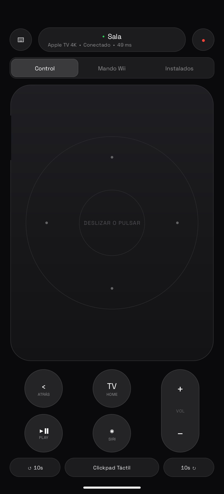
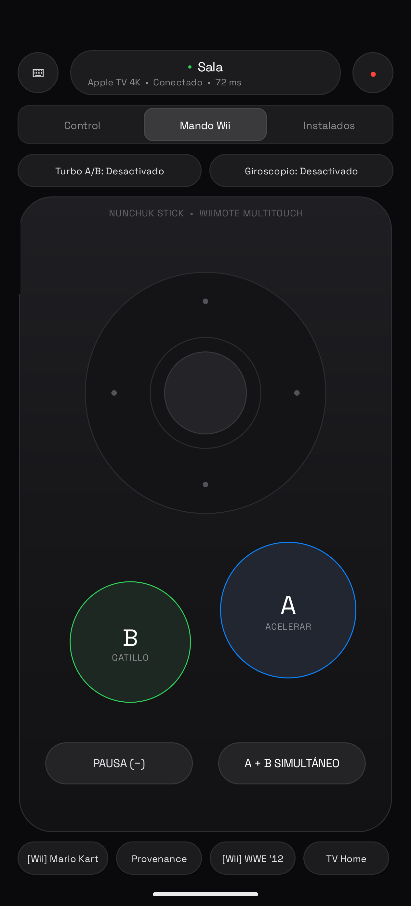
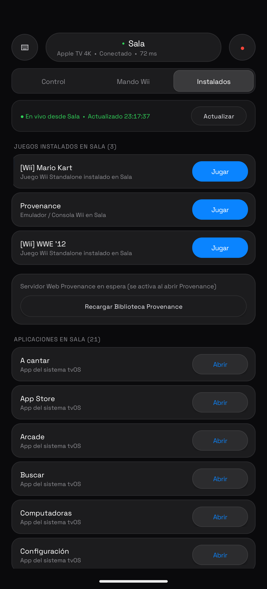
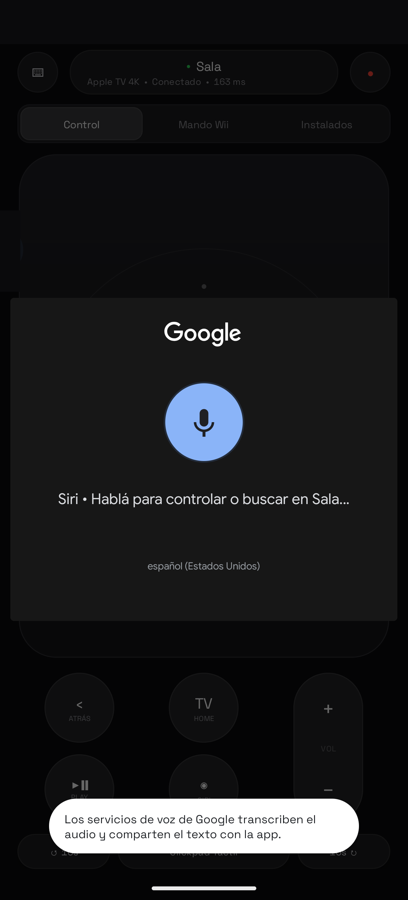

# provenance-tvos-wii

Emulador de Wii en el Apple TV, instalado como app normal, jugable con el control remoto del Apple TV y con un ícono propio por juego en el menú de inicio. Todo por Wi-Fi, con un Apple ID gratis, y renovado solo cada semana.

Se apoya en [Provenance](https://github.com/Provenance-Emu/Provenance) (que trae Dolphin) y le aplica estos parches al instalarlo:

| Parche | Para qué |
| --- | --- |
| `patch/ckstub.m` | Sin el permiso de iCloud (que un Apple ID gratis no tiene) Provenance se cierra al abrir; esta librería neutraliza CloudKit. Además deja configurado de entrada: botón Menú = menú de pausa, sombreadores asíncronos (sin tirones) y Dolphin en doble núcleo. |
| `patch/control_remoto.py` | Sin un gamepad completo, Dolphin asigna el jugador 1 a controles táctiles que en tvOS no existen. El parche lo asigna al control remoto. |
| `patch/solo_wii.py` | Las imágenes de disco (`.iso`, `.wbfs`, ...) se importan directo como Wii, sin preguntar la consola, y Wii arranca siempre con el Dolphin nativo, sin preguntar el core. |
| `patch/add_dylib.py` | Inyecta la librería en el ejecutable de Provenance. |

## Controles con el control remoto del Apple TV

| Control remoto | Wii |
| --- | --- |
| Clic de la superficie táctil | A |
| Play/Pausa | B |
| Superficie táctil (arriba, abajo, izquierda, derecha) | Cruz del Wiimote y palanca del Nunchuk |
| Menú (atrás) | Menú de pausa de Provenance (guardar, salir del juego) |
| Botón TV | Volver al inicio del Apple TV |

El control remoto tiene pocos botones: alcanza para menús y juegos simples. Para juegos que usan muchos botones, conectá un control de PlayStation o Xbox por Bluetooth (Ajustes > Remotos y dispositivos > Bluetooth); Provenance lo detecta solo y no hace falta configurar nada.

## Requisitos

- Mac con Xcode y tu Apple ID agregado en Xcode > Settings > Accounts.
- [xcodegen](https://github.com/yonaskolb/XcodeGen): `brew install xcodegen`
- Python 3 con `pip install pyatv pillow`
- El IPA de Provenance para tvOS, de sus releases oficiales.
- Tus propios juegos, copiados de tus discos. **Este repo no incluye ni descarga juegos.**

## Conectar el Apple TV a la Mac por Wi-Fi

Todo funciona por la red local: no hace falta cable.

1. **Misma red.** La Mac y el Apple TV tienen que estar en la misma red Wi-Fi (o el Apple TV por cable al mismo router).
2. **Modo de emparejamiento en el Apple TV.** Ajustes > Remotos y dispositivos > App Remote y dispositivos. Dejá esa pantalla abierta.
3. **Emparejar con Xcode.** En la Mac: Xcode > Window > Devices and Simulators. El Apple TV aparece en la lista de la izquierda; tocá **Pair** y escribí el código que muestra la tele.
4. **Modo desarrollador.** Si el Apple TV lo pide: Ajustes > Privacidad y seguridad > Modo desarrollador, activalo y dejá que se reinicie.
5. **Comprobar.** En la Terminal:
   ```sh
   xcrun devicectl list devices
   ```
   El Apple TV tiene que figurar como `available (paired)`. La columna `Identifier` es el `ATV_UDID` para `config.env`.
6. **IP fija.** La IP del Apple TV está en Ajustes > Red. Reservala en el router (DHCP reservation) para que no cambie y `config.env` siga sirviendo.
7. **Control por red** (para que los scripts despierten el Apple TV y aprieten teclas):
   ```sh
   python3 tools/atv.py pair
   ```
   Cuando la tele muestre un PIN, escribilo en `tools/atv-pin.txt`. Las credenciales quedan en `tools/atv-creds.json`, que git ignora.

Si el Apple TV entra en reposo profundo, `devicectl` no puede abrir apps; `scripts/mantener.sh` lo despierta antes.

## Instalación

```sh
cp config.example.env config.env      # completá UDID, IP, Team ID y prefijo de bundle
cp juegos.example.json juegos.json    # tus juegos: nombre del ícono, ID del disco, palabra clave
scripts/renovar.sh --forzar           # obtiene el perfil, parchea, firma e instala Provenance y los íconos
scripts/instalar-renovacion.sh        # programa la renovación diaria (la firma gratis dura 7 días)
```

## Agregar juegos

Abrí Provenance en el Apple TV: su servidor web queda en `http://<IP del Apple TV>/` y `tools/subir_juegos.py` lo usa para subir. El script vigila `~/Downloads`: cuando termina de bajar un `.zip`/`.7z` con una imagen de disco, revisa que no traiga ejecutables, lo descomprime y lo sube. Si el nombre coincide con la `clave` de algún juego de `juegos.json`, le arma su ícono con la portada de [GameTDB](https://www.gametdb.com).

El `game_id` es el ID de 6 caracteres del disco (los primeros 6 bytes del `.iso`, por ejemplo `RMCE01`).

## Modo Juegos Nativos Standalone (Inspirado en nxnative)

En lugar de instalar la aplicación Provenance con su interfaz de emulador y usar accesos directos por URL trampolín, este modo convierte cada juego de Wii en una **aplicación independiente y nativa para tvOS**:

- **Cero interfaz de emulador**: Al seleccionar el juego en el menú de inicio del Apple TV, arranca directamente en pantalla completa a 60 fps con backend Metal.
- **Ícono 3D Parallax y Top Shelf**: Portada oficial en relieve multicapa (.imagestack) y banner panorámico cinemático en el estante superior.
- **Soporte de mandos**: Control remoto del Apple TV (Siri Remote) y mandos Bluetooth (PlayStation, Xbox, Switch Pro, MFi) mapeados de fábrica.
- **Sin Provenance**: No requiere tener la app de Provenance instalada ni servidores web locales de subida.

### Empaquetar e instalar un juego standalone

1. Configurá tu `config.env` y `juegos.json`.
2. Empaquetá e instalá directamente en el Apple TV:
   ```sh
   standalone/instalar_standalone.sh
   ```
3. O empaquetá un juego manualmente:
   ```sh
   python3 standalone/empaquetar.py <Target> <GameID> /ruta/al/juego.iso
   ```

## App Android: Apple TV System Remote & Mando Wii (120 Hz)

En [`android/`](android/) se incluye una aplicación Android nativa diseñada desde cero en **Java puro (API 35, cero dependencias externas, ~72 KB APK)** que convierte un teléfono Android (optimizada para pantallas **20:9 a 120 Hz** como el **Motorola Signature**) en un control remoto nativo del sistema Apple TV y en un mando multi-touch de Nintendo Wii de baja latencia.

<p align="center">
  
  
  
  
</p>

### Arquitectura técnica del cliente Android (`com.signature.atvremote`)

- **Protocolo nativo Apple Companion (`_companion-link._tcp`) en Java puro:**
  - **HAP-SRP-6a (3072-bit) + HKDF-SHA-512:** Emparejamiento con PIN en pantalla (`Pair-Setup`) y verificación de sesión (`Pair-Verify`) en [`HapSrp.java`](android/app/src/main/java/com/signature/atvremote/protocol/HapSrp.java).
  - **Criptografía `X25519` + `Ed25519` + `ChaCha20-Poly1305`:** Implementación en [`Crypto25519.java`](android/app/src/main/java/com/signature/atvremote/protocol/Crypto25519.java) con cifrado continuo autenticado (`E_OPACK` frame `0x08`) y latencia de **~9–35 ms RTT** en red local.
  - **Serialización binaria `OPACK` y `TLV8`:** Codificador y decodificador completo en [`Opack.java`](android/app/src/main/java/com/signature/atvremote/protocol/Opack.java) y [`HapTlv8.java`](android/app/src/main/java/com/signature/atvremote/protocol/HapTlv8.java).
  - **Teclado remoto y Siri por Voz (`_tiStart` / `_tiC` + `RTIKeyedArchiver`):** Construcción de payloads binarios `NSKeyedArchiver` en [`RtiPayload.java`](android/app/src/main/java/com/signature/atvremote/protocol/RtiPayload.java) combinada con `RecognizerIntent` de Android para abrir apps/juegos por voz (*"Abrir YouTube"*, *"Jugar Mario Kart"*, *"Pausa"*) o dictar búsquedas directamente en `com.apple.TVSearch`.
- **Sincronización en tiempo real de Juegos y Aplicaciones:**
  - Consulta en vivo al Apple TV mediante `FetchLaunchableApplicationsEvent` y al servidor web de Provenance, separando automáticamente los **Juegos Wii instalados** de las **Aplicaciones de tvOS** para lanzarlos con un toque.
- **Mando Wii Multi-Touch + Giroscopio + Turbo:**
  - Superficie multi-touch (`ACTION_POINTER_DOWN`/`UP`) que permite mantener el D-Pad para conducir o moverse mientras se pulsan simultáneamente los botones **A (`HID_SELECT`)**, **B (`HID_PLAY_PAUSE`)** o **Menú (`HID_MENU`)**, con modo **Giroscopio (Tilt)** y **Turbo A/B**.
- **Privacidad de red:** Descubrimiento automático por mDNS (`NsdManager`) sin exponer direcciones IP ni puertos en la interfaz.

### Compilar e instalar en Android

```sh
./android/build.sh --install
```

## Rendimiento

Valores que deja el parche y que conviene no cambiar en Provenance / Standalone Runner:

- **Shader Compilation: Asynchronous (Uber).** Los otros modos frenan el juego un instante cada vez que aparece un efecto nuevo.
- **Graphics Backend: Metal**, **Internal Resolution: 1x**, **V-Sync** apagado y **Dual Core** prendido.

El CPU queda en **Cached Interpreter**: tvOS solo permite el modo JIT (más rápido) con un depurador conectado, así que juegos muy exigentes pueden ir algo más lentos que en una Wii.

## Límites

- Con un Apple ID gratis, Apple permite 3 apps firmadas a la vez en el dispositivo: con el modo Standalone podés tener 3 juegos independientes completos instalados directamente en el inicio.
- La firma vence a los 7 días; `standalone/renovar_standalone.sh` la renueva sola si la Mac está prendida.

## Licencia

MIT para el código de este repo. Provenance, Dolphin y los juegos tienen sus propias licencias y no se distribuyen acá.

